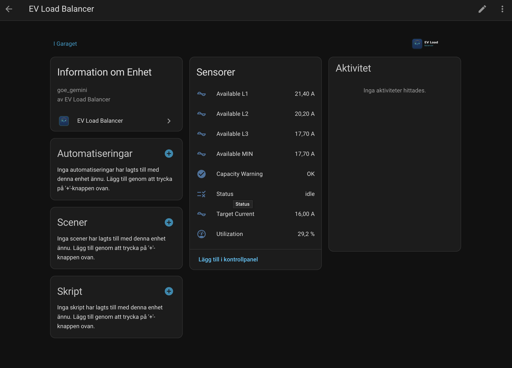
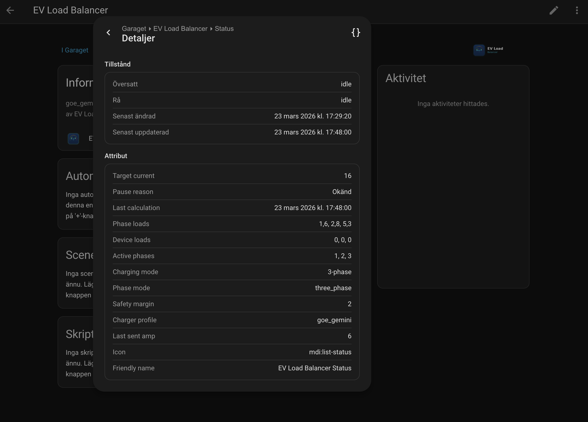
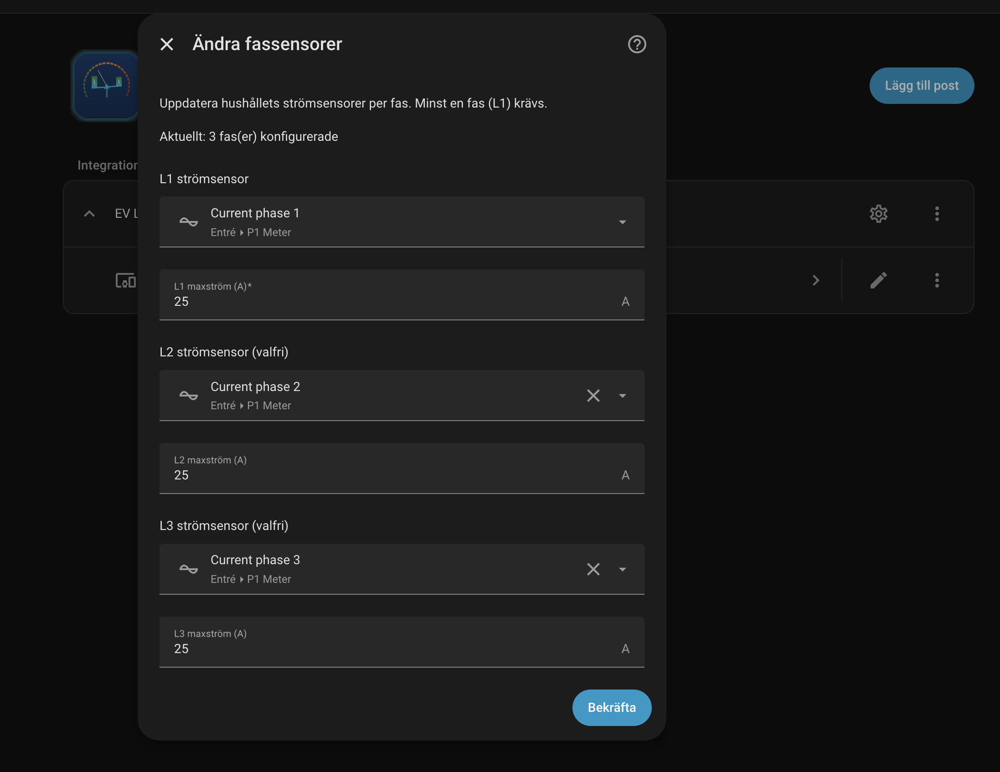
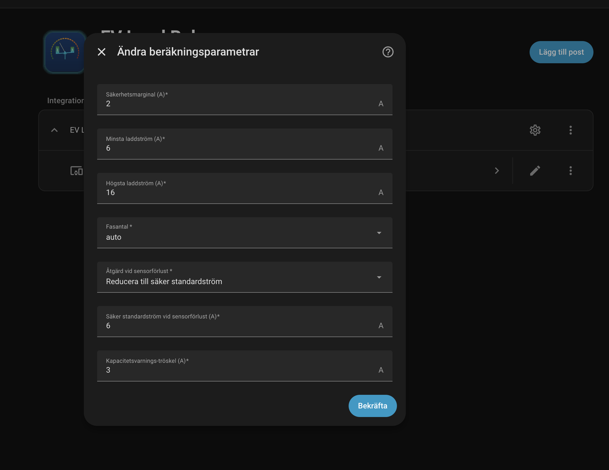

# EV Load Balancer

Dynamic load balancing for EV chargers in Home Assistant. Measures current per
phase at the main fuse and adjusts the charger's output power in real time to
prevent the fuse from tripping. Supports phase switching (1↔3 phase), failsafe
modes and charger profiles. MVP: go-e Gemini flex.

[](https://github.com/hacs/integration)
[](https://github.com/cryptotomte/ev-load-balancer/actions/workflows/validate.yaml)



---

## Features

- **Phase-specific load balancing** — measures and balances current per phase (L1, L2, L3)
- **Event-driven calculation** with immediate downward adjustment on load increase
- **Stable charging current** — the household load is estimated from the phase value and the
  charger's current at the same moment, so the charger's own changes never look like new load
- **Hold time before increase** — the current is raised only when the household load has
  stayed low for a while (default 90 s)
- **Automatic phase switching** — dynamically switches between 3-phase and 1-phase charging,
  at most once every 300 s
- **Failsafe on sensor loss** — reduce (6A) or pause depending on configuration
- **Configurable safety margin** — adds a buffer below the fuse limit
- **Charger profiles** — modular support for different charger models (MVP: go-e Gemini flex)
- **HA events** for automations and notifications on all state changes
- **Capacity warning sensor** — binary sensor + event when capacity margin is low
- **Utilization sensor** — shows fuse utilization as a percentage

---

## How It Works

EV Load Balancer operates in a continuous cycle: measure → calculate → control.

```
Current per phase at the fuse (P)        Charger's own current per phase
  sensor.grid_current_l1 (L1: 18.3 A)      sensor.goe_{serial}_nrg_4/5/6
  sensor.grid_current_l2 (L2: 12.1 A)      (kept as history, no calculation)
  sensor.grid_current_l3 (L3: 15.7 A)
            │                                       │
            ▼                                       ▼
    ┌──────────────────────────────────────────────────────┐
    │  Household load per phase (h)                        │
    │  P is a few seconds old when it arrives, so it is    │
    │  compared with the charger's current during the      │
    │  last W seconds (measurement window, default 15 s):  │
    │    low  = P - highest charger current in the window  │
    │    high = P - lowest charger current in the window   │
    │    h is kept within [low, high]                      │
    │                                                      │
    │  Budget per phase = 25 - h - 2 (margin)              │
    │  target_current = floor(lowest budget of the active  │
    │    phases), clamped to [6, 16] A                     │
    └──────────────────────────────────────────────────────┘
            │
            ▼
    ┌───────────────────────┐    ┌─────────────────────────┐
    │   Control             │    │   Pause and phases      │
    │                       │    │                         │
    │  Lower target: sent   │    │  budget < min 15 s      │
    │  at once              │    │    → PAUSE              │
    │                       │    │  budget > min+2 A 30 s  │
    │  Higher target: only  │    │    → RESUME (capped     │
    │  on an unambiguous    │    │      like an increase)  │
    │  value, capped by the │    │                         │
    │  hold time (90 s),    │    │  all phases >= 6 A for  │
    │  5 s between raises   │    │  60 s → 3-phase; at     │
    │                       │    │  most one switch / 300 s│
    └───────────────────────┘    └─────────────────────────┘
            │
            ▼
  number.goe_{serial}_amp  (sets charging current)
  select.goe_{serial}_frc  (pause/resume)
  select.goe_{serial}_psm  (phase selection)
```

The status sensor exposes all calculation details as attributes — useful for debugging
and dashboard cards:



### Calculation logic (step by step)

1. **Sample**: A new value from a phase sensor is a sample. Values from the three phase
   sensors that arrive within 0.2 s are one sample. A change of the charger's own current
   (`nrg_4/5/6`) only adds to the history; it never starts a calculation.
2. **Household load**: Per phase, the phase value `P` is compared with the charger's current
   during the last `W` seconds before the value was reported (the measurement window). The
   household load `h` is kept within `[P - highest, P - lowest]` charger current in the window.
   If the charger stood still, `h` is exact; if it changed, `h` moves only as far as the value
   proves.
3. **Budget**: `max_ampere - h - safety_margin` per phase. `target_current = floor(lowest
   budget of the active phases)`, clamped to [min_current, max_current].
4. **Lower target**: sent at once, in one step, at the first value that proves the higher load.
5. **Higher target**: sent only when the latest value on every active phase was unambiguous
   (`high - low` at most 0.5 A, with history covering the whole window), and never above what
   the highest household load of the hold time (default 90 s) allows. At least 5 s between
   increases. Every command the balancer sends (current, pause, phase switch) counts as a
   change in the window, so after its own command the next increase is possible only when
   the window has passed.
6. **Pause**: If the budget is below min_current for 15 seconds → pause charging.
7. **Resume**: If the budget is above min_current + 2 A for 30 seconds → resume charging,
   capped like an increase (step 5).
8. **Phase switching**: 3 → 1 phase at once when a phase lacks capacity; 1 → 3 phase when all
   phases have had at least min_current for 60 s. Before switching up, the current is first
   reduced to what all phases allow, including the highest household load of the hold time
   on each phase; if that is below min_current, no switch is made. No new phase switch within
   300 s of the previous one, and the 60 s count starts only after those 300 s, so an
   up-switch comes 360 s after a down-switch at the earliest. During that time a shortage is
   handled by a lower current and, if needed, a pause.
9. **Clock**: While starting up, charging or paused, the balancer recalculates every 5 s with
   the existing estimate, so start-up, the pause, resume, phase switch and hold timers run out
   even when no new phase values arrive. This is not a new sample.
10. **Car plugged in or out**: When the car is plugged in and the charger draws no current
    yet, the calculated current is sent at once, capped by the highest household load of the
    hold time (step 5). When it is unplugged, the current is set to min_current.
11. **Start and reload**: The charger's current setting (`amp`) shown in Home Assistant is
    not trusted. When the balancer first sees the car connected and the charger is already
    drawing current (a restart or reload while charging, or a car status that becomes known
    only after the start), it sends one synchronising command at once: the lower of the
    target and the charger's measured current rounded up, but at least min_current. It can
    never raise what the charger actually draws; any increase after it follows step 5. If
    the charger's current cannot be measured, the command is the target capped as in
    step 10. If a car is charging, or the car status cannot be read at the start (counted
    as charging), the phase setting (`psm`) is left as it is and no phase switch is made for
    300 s.

---

## Prerequisites

Verify the following before installation:

**Home Assistant:**
- [ ] Home Assistant 2024.12.0 or later
- [ ] HACS installed ([instructions](https://hacs.xyz/docs/setup/download))

**Hardware:**
- [ ] EV charger installed and connected to the home network
- [ ] Per-phase current measurement at the main fuse installed

**Home Assistant integrations:**
- [ ] Charger integration installed in HA (e.g. [ha-goecharger-api2](https://github.com/cathiele/ha-goecharger-api2) for go-e)
- [ ] Phase sensors exposed in HA (e.g. via P1 port, Shelly EM) that update often enough for
      the measurement window: every 10 seconds with the defaults — see the note below the table

**Network requirements:**
- [ ] Home Assistant and the EV charger on the same network (or routable)
- [ ] Charger API accessible (local network communication, no cloud required)

**Current measurement — options:**

| Option | Integration | Sensors |
|---|---|---|
| Nibe Modbus (heat pump) | nibe-hass | ⚠️ Not suitable: BE1–BE3 written every 61 s (measured) |
| P1 port (Tibber, Easee home) | tibber-local | Per-phase current |
| Shelly EM | Shelly HA | Per-phase current |
| Eigil Stromberg | Modbus | Per-phase current |

> **Important:** The sensors must show current in Ampere per phase *at the main fuse* —
> not at the distribution board or at the charger. It is the total load per phase
> that determines whether the fuse is at risk of tripping.

> **Update rate:** The default measurement window (15 s) suits a phase sensor whose value
> updates every 10 seconds. A slower sensor needs a longer window: the window must be longer
> than the sensor's update interval plus the time a value takes to reach Home Assistant, and
> it can be at most 30 seconds (see Advanced settings). A sensor slower than that is not
> suitable. A new phase value is also what lets the balancer reduce the current, so a slow
> sensor delays every reduction. Measured counter-example: Nibe's current sensors (BE1–BE3)
> are written every 61 seconds and are not good enough.
>
> **Sensors that only report changes:** Some integrations write a sensor only when its
> value changes. After one of its own adjustments the balancer then raises the charge
> current, or resumes charging after a pause, only once every active phase has reported a
> new value. While a phase value stays exactly the same, the raise or the resume does not
> come at all. Reductions are never delayed by this.

---

## Charger Setup

### go-e Charger Gemini flex

See the full setup guide:
[docs/charger-profiles/goe-gemini.md](docs/charger-profiles/goe-gemini.md)

The guide covers:
- Firmware requirements (≥ 59.x, API v2)
- Installation of `ha-goecharger-api2`
- All entities that EV Load Balancer needs
- Recommended `ama` value (safe maximum)
- Verified phase mapping

### Other chargers

EV Load Balancer supports any charger that exposes the right entities in Home Assistant.
See [docs/charger-profiles/README.md](docs/charger-profiles/README.md) for requirements and
how to contribute support for your charger model.

**General requirements for the charger integration:**

- [ ] `number.*_amp` — current setting (6–32A), readable and writable
- [ ] `select.*_frc` — force charge status (pause/resume), writable
- [ ] `select.*_psm` (optional) — phase selection (1/3 phase), writable
- [ ] `sensor.*_nrg_4/5/6` (optional) — current per phase, readable

> **Without the charger's current sensors** (`nrg_4/5/6`, e.g. a generic profile that does
> not define them) the balancer can never prove that the household load has gone down.
> The current is then never raised after the first value sent at plug-in or after a
> restart, and charging never resumes after a pause.

---

## Installation

### Via HACS (recommended)

1. Open HACS in Home Assistant (**HACS** → **Integrations**)
2. Click the menu (⋮) at the top right → **Custom repositories**
3. Paste the URL: `https://github.com/cryptotomte/ev-load-balancer`
4. Select category: **Integration**
5. Click **Add** → find **EV Load Balancer** in the list → click **Download**
6. Restart Home Assistant
7. Go to **Settings** → **Devices & Services** → **+ Add integration**
8. Search for **EV Load Balancer** and follow the configuration guide below

### Manual installation

1. Copy the folder `custom_components/ev_load_balancer/` to your HA
   `custom_components/` folder
2. Restart Home Assistant
3. Add the integration via **Settings** → **Devices & Services**

---

## Configuration

### Config Flow (initial setup)

The configuration flow consists of six steps:

| Step | Content |
|---|---|
| **1. Charger profile** | Select charger model (e.g. go-e Gemini flex) |
| **2. Serial number** | Enter the charger's serial number |
| **3. Entities** | Confirm or adjust entity IDs |
| **4. Phases** | Configure phase sensors and fuse limits per phase |
| **5. Parameters** | Safety margin, min/max current, failsafe behavior |
| **6. Confirm** | Review settings and create the integration |

### Options Flow (post-configuration)

Settings can be adjusted afterwards without having to remove and recreate the integration:

- **Phase sensors** — change sensors or fuse limits
- **Calculation parameters** — safety margin, min/max current
- **Failsafe behavior** — action on sensor loss (reduce/pause) and safe default current
- **Capacity warning threshold** — limit in Ampere for warning sensor (default 3A)
- **Advanced settings** — a collapsed section at the bottom of the calculation parameters step:

  | Setting | Default | Allowed | What it does |
  |---|---|---|---|
  | Measurement window (s) | 15 | 3–30 | How far back the charger's current is compared with each phase value. Must be longer than the meter's update interval plus the time it takes for the value to reach Home Assistant. A window that is too short makes the charge current oscillate. |
  | Hold time before increase (s) | 90 | 0–600 | How long the household load must have stayed low before the charge current is raised. |

  The defaults suit an electricity meter that updates every 10 seconds. Existing installations
  use the defaults until the settings are changed.

Open Options Flow via: **Settings** → **Devices & Services** → **EV Load Balancer** → ⚙️

| Phase sensors | Calculation parameters |
|---|---|
|  |  |

---

## Who Does What?

Responsibility split between EV Load Balancer, the charger integration and
EV Charging Manager (EVCM).

| Function | EV Load Balancer | Charger integration | EV Charging Manager |
|---|---|---|---|
| Current measurement at fuse | Reads sensors | — | — |
| Calculate available capacity | ✅ | — | — |
| Control charging current (amp) | ✅ Writes | Exposes entity | — |
| Pause/resume (frc) | ✅ Writes | Exposes entity | — |
| Phase switching (psm) | ✅ Writes | Exposes entity | — |
| Failsafe on sensor loss | ✅ | — | — |
| Identify who is charging | — | — | ✅ (RFID) |
| Session management | — | — | ✅ |
| Cost calculation | — | — | ✅ |
| Spot price reading | — | — | ✅ (reads, does not control) |
| API communication with charger | — | ✅ | — |

**EV Load Balancer** focuses solely on load balancing — keeping the grid load
below the fuse limit. The integration does *not* communicate directly with the
charger hardware but goes via the entities exposed by the charger integration.

**The charger integration** (e.g. ha-goecharger-api2) is responsible for all
communication with the charger and exposes the entities that EV Load Balancer controls.

**EV Charging Manager** (separate integration) handles sessions, RFID cards,
cost calculation and spot price optimization — features that are outside
EV Load Balancer's scope.

> The three components are **independent** and can be installed individually.
> EV Load Balancer + charger integration + EVCM can run simultaneously without conflict.

---

## Optional: InfluxDB + Grafana

EV Load Balancer can export load balancing decisions to InfluxDB for
historical analysis and visualization in Grafana.

### Flow A — Continuous sensor data (HA built-in)

Home Assistant automatically logs sensors to its internal database. Configure
the InfluxDB integration in HA to also send these sensors:

```yaml
# configuration.yaml
influxdb:
  host: <your-influxdb-host>
  include:
    entities:
      - sensor.ev_load_balancer_status
      - sensor.ev_load_balancer_available_min
      - sensor.ev_load_balancer_target_current
      - sensor.ev_load_balancer_utilization
```

### Flow B — Event export (automation template)

Import the automation template `automations/ev_load_balancer_influxdb_export.yaml`
in Home Assistant to export all load balancing events to
measurement `ev_load_balancer_events`.

**Events exported:**

| Event | Measurement | Tags | Fields |
|---|---|---|---|
| `ev_load_balancer_current_adjusted` | ev_load_balancer_events | event_type, charger_profile, state | old_current, new_current, available, reason |
| `ev_load_balancer_device_paused` | ev_load_balancer_events | event_type, charger_profile, state | reason, available_min |
| `ev_load_balancer_device_resumed` | ev_load_balancer_events | event_type, charger_profile, state | reason, available_min |
| `ev_load_balancer_phase_switched` | ev_load_balancer_events | event_type, charger_profile | from_mode, to_mode, reason |

`ev_load_balancer_phase_switched` is fired on every phase switch the balancer makes (earlier
versions listed it but never fired it). `from_mode` and `to_mode` are `1-phase` or `3-phase`.

### Grafana queries

| Visualization | InfluxDB query (concept) |
|---|---|
| Current adjustments per day | `COUNT(new_current) WHERE event_type='current_adjusted' GROUP BY time(1d)` |
| Average allocated current | `MEAN(new_current) WHERE event_type='current_adjusted' GROUP BY time(1h)` |
| Number of pauses per week | `COUNT(*) WHERE event_type='device_paused' GROUP BY time(7d)` |
| Pause reasons (distribution) | `COUNT(*) WHERE event_type='device_paused' GROUP BY reason` |
| Phase switches per day | `COUNT(*) WHERE event_type='phase_switched' GROUP BY time(1d)` |
| Capacity utilization | `MEAN(utilization_pct) GROUP BY time(1h)` |
| Lowest margin per day | `MIN(available_min) GROUP BY time(1d)` |

---

## Troubleshooting

### Charger does not respond to adjustments

**Symptom:** Charging current does not change even though EV Load Balancer is
active and shows a calculated value.

**Check:**
1. Verify that the charger is in the correct mode — `frc` must allow external control
   (not forced off or on)
2. Check that entity IDs are correctly configured (**Settings** → **EV Load Balancer** → ⚙️)
3. Check HA logs (`home-assistant.log`) for error messages from EV Load Balancer
4. Verify that the charger integration is active and that entities do not show `unavailable`

### Sensors show `unavailable`

**Symptom:** `sensor.ev_load_balancer_status` or phase sensors show `unavailable`.

**Check:**
1. Verify that the phase sensors work: open **Developer Tools** → **States**
   and search for your phase sensors
2. Check the network connection to the current meter (Shelly, P1 port)
3. If phase sensors are unavailable the **failsafe** activates — check the selected action
   (reduce/pause) in Options Flow
4. Restart Home Assistant and wait ~30 seconds for sensors to initialize

### Fuse tripped anyway

**Symptom:** Despite EV Load Balancer being active the fuse trips.

**Check:**
1. Check the size of the safety margin — increase from default (2A) to 3–5A
   via Options Flow
2. Verify that the phase sensors measure at the *correct point* — at the main fuse,
   not at the distribution board or the charger
3. Check that `ama` (absolute maximum value) on the charger is set to a safe
   value (recommendation: 10A) — see [goe-gemini.md](docs/charger-profiles/goe-gemini.md)
4. Verify that no other large loads (stove, oven) switched on instantaneously —
   EV Load Balancer reacts to sensor readings, not predictively

### HA restart — integration shows INITIALIZING

**Symptom:** After HA restart the integration is in `INITIALIZING` state
for a while.

**Explanation:** This is normal behavior. After a restart the integration waits for
Home Assistant to publish initial sensor values before it can calculate the
correct current. This typically takes 10–30 seconds.

**If the state persists:**
1. Check that the phase sensors return numeric values (not `unavailable`)
2. Verify that the charger integration is correctly configured and the entities are
   available
3. Check the logs for any errors during startup

---

## Charger Profiles (Community)

EV Load Balancer is designed with a modular profile architecture. The MVP version
includes support for go-e Gemini flex. Support for more chargers is added via
community contributions.

**Available profiles:**

| Profile | Charger | Status | Guide |
|---|---|---|---|
| `goe_gemini` | go-e Charger Gemini flex | ✅ MVP | [goe-gemini.md](docs/charger-profiles/goe-gemini.md) |

**Want to contribute support for your charger?**

Read [docs/charger-profiles/README.md](docs/charger-profiles/README.md) for a
template and instructions on how to open a Pull Request.

---

## Relation to EV Charging Manager

[EV Charging Manager](https://evchargermanager.de/) (EVCM) is a separate
integration for Home Assistant that handles charging sessions, RFID cards,
cost calculation and scheduling based on spot prices.

**EV Load Balancer and EVCM are independent integrations** that address
different problems:

- **EV Load Balancer** → *How much can I charge right now without the fuse tripping?*
- **EV Charging Manager** → *Who is charging? What does it cost? When should I schedule charging?*

They can and **should be installed together** if you want complete
charging management. EV Load Balancer sets the capacity ceiling — EVCM optimizes
the schedule within that ceiling.

> **Note:** EV Charging Manager can read spot prices and plan charging,
> but does not control load balancing. EV Load Balancer does not control charging
> schedules or price sensitivity — it is purely real-time balancing.

---

## License

MIT License — see [LICENSE](LICENSE) for details.

Copyright (c) 2026 cryptotomte

Permission is hereby granted, free of charge, to any person obtaining a copy
of this software and associated documentation files (the "Software"), to deal
in the Software without restriction, including without limitation the rights
to use, copy, modify, merge, publish, distribute, sublicense, and/or sell
copies of the Software, and to permit persons to whom the Software is
furnished to do so, subject to the following conditions:

The above copyright notice and this permission notice shall be included in all
copies or substantial portions of the Software.

THE SOFTWARE IS PROVIDED "AS IS", WITHOUT WARRANTY OF ANY KIND, EXPRESS OR
IMPLIED, INCLUDING BUT NOT LIMITED TO THE WARRANTIES OF MERCHANTABILITY,
FITNESS FOR A PARTICULAR PURPOSE AND NONINFRINGEMENT. IN NO EVENT SHALL THE
AUTHORS OR COPYRIGHT HOLDERS BE LIABLE FOR ANY CLAIM, DAMAGES OR OTHER
LIABILITY, WHETHER IN AN ACTION OF CONTRACT, TORT OR OTHERWISE, ARISING FROM,
OUT OF OR IN CONNECTION WITH THE SOFTWARE OR THE USE OR OTHER DEALINGS IN THE
SOFTWARE.
